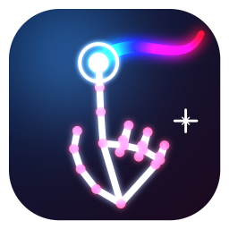

<p align="center"></p>

# Skytouch

Skytouch is a real-time computer vision app that turns hand gestures into a digital canvas, image editor, and live video filter interface using OpenCV and MediaPipe. Draw, add shapes, and edit images in the air in front of a webcam, with no mouse, stylus or touchscreen.

**Status:** In development since September 2026 · **Author:** Kelvin Osei

In usability testing with 15 people, new users got comfortable in **2 minutes** and **80% (12/15) would use it again**. After a gesture-reliability rework, accidental triggers dropped from **10 per session to 1** (see [Results so far](#results-so-far)).

---

## Why Skytouch

Drawing or marking up images on a computer usually needs a mouse, trackpad or drawing tablet. A mouse is clumsy for drawing, a tablet is extra hardware, and neither works when you're standing away from your desk. Skytouch tests a simple idea: a webcam and your hands are enough for quick, expressive drawing and live visual effects.

**Who it's for**
- **Students and hobbyists** who want a fun creative tool with no extra hardware
- **Presenters, teachers and streamers** who want to draw or apply effects live on camera
- **Developers learning computer vision**, who can use it as a reference project

**Not in scope:** replacing professional drawing software, mobile support, and cloud accounts or online sharing.

---

## Results so far

| Goal | Metric | Target | Result |
| --- | --- | --- | --- |
| Feels responsive | Hand-tracking frame rate | 30+ FPS | ✅ 30+ FPS on the development machine |
| Easy to learn | Time for a new user to get comfortable without help | Under 3 minutes | ✅ 2 minutes |
| Worth coming back to | Testers who would use it again | 70%+ | ✅ 80% (12/15) |
| Gestures are reliable | Unintended gesture triggers in a 5-minute session | 1 or fewer | ✅ 1 observed, down from 10 |

The first round of testing showed that accidental gestures were the main problem (10 per session). The fix:
- **Steadier tracking:** One Euro smoothing on every hand landmark, so the hand reading stays still when your hand does.
- **Stricter gestures:** finger detection that works at any hand angle, with hysteresis so fingers don't flicker between up and down. A pose has to hold for 0.1s before it counts, and held actions fire once per hold.
- **Fewer gestures:** brush, shape and filter selection moved to the on-screen toolbar with preview menus, so fewer hand shapes compete with each other.

In the latest retest, only **1 misfire** remained: a stroke drawn while pointing at something.

---

## Features & Controls

### Hand Gestures
* **Freehand Draw:** Raise **Index Finger** only.
* **Drag Bounding Shape:** **Pinch** (Thumb + Index Finger), drag, and release to place. Tiny accidental drags are ignored. Shapes: rectangle, ellipse, line, circle, triangle (pick one from the toolbar's shape menu).
* **Drag Uploaded Image:** Raise **Index + Middle** fingers (Peace sign) and move your hand (only while an image is loaded).
* **Scale Uploaded Image:** Peace sign on **both hands**. Move your hands closer together to shrink the image, or farther apart to enlarge it.
* **Cycle Color:** Hold **Index + Pinky** fingers up. Colors: red, green, blue, yellow.
* **Undo Action:** Hold **Pinky + Thumb** out (Shaka). Also undoes filter changes.
* **Clear Canvas:** Hold a closed **Fist** for ~1.5s (progress bar fills).
* **Viewport Filter Box:** Make an **"L"** (thumb + index) with **both hands** to frame a region. It uses the filter picked in the toolbar's filter menu; framing again without picking cycles to the next one.
* **Idle:** An open palm does nothing. Held gestures fire once per hold, so release and hold again to repeat. A ring around your fingertip shows hold progress, and the current gesture is shown in the bottom-left.

### Live Filters
Pick one from the toolbar's filter menu (it restyles the box already on screen, or is used for your next frame). Framing again without picking cycles to the next filter. 12 filters you can apply to any framed region: grayscale, invert, sepia, Sobel edges, blur, pixelate, thermal, glass, ASCII, night vision, kaleidoscope, and **glitch** (split RGB channels, torn scanlines and color bursts that change every frame, like a broken video signal). The filter stays in place and is included when you save.

### On-Screen Toolbar
A button strip along the top edge: color, shape, brush, filter, eraser, undo, clear, save, record, gallery, and pause. **Point** at a button and hold still for about 0.6s to press it (a bar fills as you hover). Your finger doesn't draw while it's over the toolbar.

**Shape**, **Brush** and **Filter** open a pop-up menu with a preview of every option: shapes and brushes are drawn in your current color, and filters are shown live on your camera feed. Hover a tile (or click it) to pick it. Hover **Close**, click outside the menu, or press `Esc` to dismiss it. Drawing and gestures are paused while a menu is open.

### Brush Styles
Pick from the toolbar's brush menu, or cycle with `b`:
**Solid**, **Neon**, **Rainbow** (color shifts as you draw), **Ink** (thinner when you move fast, thicker when slow), **Calligraphy** (slanted nib, thick or thin depending on direction), **Spray** (spray-paint dots), **Sparkle** (line with glitter and stars), and **Dashed**.

**Eraser** is its own toggle: press the toolbar's eraser button or `e` to erase, and press it again to go back to the brush you were using.

### Pause
Pause the canvas (toolbar or `p`) to move around freely. All gestures are off while paused, and the toolbar stays visible so you can resume hands-free.

### Gallery & Saves
Saves go to the `saves/` folder with a timestamp, so nothing gets overwritten. Images are PNG and recordings are MP4. The gallery (toolbar or `g`) shows all your saves as thumbnails. Point and hold on one, or click it with the mouse, to open it.
* **Videos:** play/pause and a seek bar (hover or click a spot to jump there).
* **Images:** **Edit** puts the image back on the canvas so you can keep drawing on it (undoable).
* **Show File** / **Open Folder** opens it in your file explorer so you can share it.

### Window
Skytouch opens fullscreen with its own icon in the title bar and taskbar. Press `f` to toggle fullscreen (`Esc` also leaves it). Toolbar buttons can be clicked with the mouse too.

### Keyboard Shortcuts
* `p` – Pause / resume the canvas.
* `g` – Open / close the gallery (`a` / `d` = previous / next, `space` = play/pause, `e` = edit image, `Esc` = back).
* `f` – Toggle fullscreen.
* `t` – Show / hide the toolbar.
* `b` – Cycle brush style (the toolbar's brush button opens the brush menu instead).
* `e` – Toggle the eraser on / off.
* `c` – Clear canvas.
* `r` – Toggle video recording (MP4).
* `u` – Upload image from computer for editing.
* `s` – Save current canvas artwork as a PNG (without the camera feed).
* `q` – Quit application.

---

## Prerequisites

* Python 3.10+ (Tested on Python 3.12)
* Web camera
* [`uv`](https://docs.astral.sh/uv/) (Python package installer and runner)

---

## Installation & Usage

1. **Clone the repository:**
   ```bash
   git clone https://github.com/kekcodenoob/skytouch.git
   cd skytouch
   ```

2. **Install `uv` (if not already installed):**

   *macOS / Linux:*
   ```bash
   curl -LsSf https://astral.sh/uv/install.sh | sh
   ```

   *Windows (PowerShell):*
   ```powershell
   powershell -ExecutionPolicy ByPass -c "irm https://astral.sh/uv/install.ps1 | iex"
   ```

3. **Install dependencies from `uv.lock`:**
   ```bash
   uv sync
   ```

4. **Check that your camera works then run the application:**
   ```bash
   uv run main.py
   ```

---

## Roadmap

1. ~~**Fewer accidental gestures**~~ ✅ Down from 10 to 1 per session. Next: track down the last accidental draw.
2. ~~**On-Screen UI Toolbar**~~ ✅ Done (hover-to-press buttons, with shape, brush and filter preview menus). Next: brush sizes.
3. ~~**Canvas Toggle On/Off**~~ ✅ Done (pause).
4. **Custom Color Palette:** pick custom RGB colors from a virtual color wheel.
5. **Multi-Hand Canvas Collaboration:** simultaneous drawing and shape manipulation with two hands or two people.

## Known Risks

- **Gesture collisions:** similar hand shapes can trigger the wrong action. Much reduced (1 misfire in the latest retest) by landmark smoothing, angle-based finger detection, hysteresis and pose debouncing.
- **Discoverability:** the remaining gestures still have to be learned, but every option is also on the toolbar, and the menus show what each choice looks like before you pick it.
- **Environment:** poor lighting or a low-quality webcam reduces tracking accuracy.
- **Keyboard still needed:** uploading an image uses a key press and a file dialog.

## Open Questions

- The last misfire was an accidental stroke while pointing. Should drawing need a short "pen down" delay, or a different pose than plain pointing?
- What did the 3 testers who wouldn't use it again say?
- Which user group should come first: creative hobbyists or presenters and streamers?

<details>
<summary><b>User stories & acceptance criteria</b></summary>

1. **Freehand drawing.** As a user, I want to draw by pointing, so it feels like drawing in the air.
   - Raising only the index finger draws a stroke
   - Color can be changed with a hold gesture, and brush style from a toolbar menu with previews, without touching the keyboard
2. **Shapes.** As a user, I want clean shapes without steady-hand drawing.
   - A thumb + index pinch and drag places the current shape
   - The shape is picked from a toolbar menu that previews each one
3. **Image editing.** As a user, I want to bring in my own photo and position it.
   - `u` uploads an image; a peace sign drags it; a peace sign on both hands scales it
4. **Live filters.** As a presenter or streamer, I want effects on just part of the frame.
   - Two hands frame a region; the filter persists and is included in saves
5. **Fixing mistakes.** As a user, I want to undo without starting over.
   - The shaka gesture undoes the last action, including filter changes
   - Clearing requires holding a fist until the progress bar fills
6. **Saving and sharing.** As a user, I want to keep what I made.
   - `s` saves a PNG without the camera feed; `r` records the session as MP4
   - Saves are timestamped and browsable in the in-app gallery

</details>
